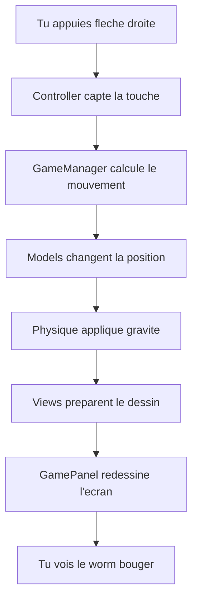

# Diagramme d'Architecture - Projet Worms

## Vue d'ensemble
Ce document présente un diagramme complet des classes principales et leurs interactions dans le projet Worms, organisé selon le pattern **MVC (Modèle-Vue-Contrôleur)**.

---

## Classes Principales et Interactions

### Point d'entree
- **GameLauncher** : Classe principale qui initialise le jeu
  - Cree GameManager et GameLoop
  - Lance la boucle de jeu

### Noyau du Jeu (MVC)
```
┌─────────────────┐
│   GameLauncher  │
└─────────────────┘
         │
         ▼
┌─────────────────┐ ◄─── ┌─────────────────┐
│   GameManager   │      │    GameLoop     │
└─────────────────┘      └─────────────────┘
         │
         ▼
    ┌─────────────┐ ──► ┌─────────────┐ ◄── ┌─────────────┐
    │ Controllers │     │    Models   │     │    Views    │
    └─────────────┘     └─────────────┘     └─────────────┘
```

* GameLoop → GameManager : GameLoop appelle les updates de GameManager
* Controllers → Models : Controllers modifient l'etat des Models  
* Models → Views : Views lisent les donnees des Models pour l'affichage

---

## Detail des Interactions

### GameManager (Coeur logique)
**Responsabilites :** Gere les equipes, personnages, physique, rounds
- **Equipes :** TeamModel[] (maintenant dynamique)
- **Personnages :** CharacterModel[]
- **Physique :** PhysicsWorld
- **Terrain :** GroundModel / BlockGridModel

**Interactions principales :**
- **→ GameLoop** : Fournit l'etat du jeu pour la boucle
- **→ Controllers** : Recoit les entrees utilisateur
- **→ Models** : Met a jour la logique (equipes, inventaire, projectiles)
- **→ Views** : Met a jour l'affichage via GamePanel

### GameLoop (Boucle principale)
**Responsabilites :** Gestion du timing (60 FPS), physique, rendu
- **Timer :** javax.swing.Timer a 16ms (~60 FPS)
- **Physique :** Mise a jour PhysicsWorld
- **Rendu :** Appel repaint() sur GamePanel

**Interactions :**
- **→ GameManager** : Appelle update() pour la logique
- **→ GamePanel** : Declenche le repaint()
- **→ PhysicsWorld** : Met a jour la physique JBox2D

### Controllers (Gestion des entrees)
| Classe | Responsabilite | Interactions |
|--------|---------------|--------------|
| **CharacterController** | Mouvement, tir, changement d'arme | → GameManager, → CharacterModel |
| **CameraController** | Zoom, deplacement camera | → CameraModel |
| **ItemController** | Gestion projectiles/items | → GameManager, → Projectile |
| **SwingInputController** | Capture clavier/souris | → Tous les controllers |

### Models (Logique metier)
| Categorie | Classes principales | Responsabilites |
|-----------|-------------------|---------------|
| Equipes | TeamModel, TeamInitialisation | Gestion des equipes de worms |
| Personnages | CharacterModel | Position, vie, inventaire d'un worm |
| Terrain | GroundModel, BlockGridModel, TerrainGenerator | Geometrie du terrain |
| Physique | PhysicsWorld | Monde JBox2D, collisions |
| Items | InventoryModel, Item, Weapon, Gadget | Armes, gadgets, inventaire |
| Projectiles | Projectile | Physique des tirs |
| Utilitaires | PerlinNoise, PlayerData | Generation procedurale, sauvegarde |

### Views (Affichage)
| Classe | Responsabilite | Technologies |
|--------|---------------|--------------|
| GamePanel | Panel principal, rendu complet | Swing, Graphics2D |
| TeamView | Affichage d'une equipe | Sprites, couleurs |
| CharacterView | Rendu d'un worm | Images, animations |
| InventoryOverlay | Interface inventaire | JDialog, boutons |
| TrajectoryRenderer | Trajectoire de tir (Angry Birds) | Mathematiques, courbes |
| ProjectileView | Affichage projectiles | Particules, effets |

---

## Flux de Donnees Typique

Imagine que tu appuies sur la fleche droite pour bouger ton worm. Voici ce qui se passe :



### Exemple concret :
1. **Tu appuies** sur une touche (ex: fleche droite)
2. **Controller** detecte et dit "le joueur veut aller a droite"
3. **GameManager** decide "OK, bouger le worm de 5 pixels a droite"
4. **Models** mettent a jour la position du worm dans le code
5. **Physique** verifie les collisions et applique la gravite
6. **Views** calculent comment dessiner le worm a sa nouvelle position
7. **GamePanel** efface l'ancien dessin et redessine tout
8. **Ecran** affiche le worm a sa nouvelle position - tu le vois bouger !

## Architecture MVC Implementee

### Modele (Model)
- **Logique metier** : TeamModel, CharacterModel, PhysicsWorld
- **Donnees** : PlayerData, InventoryModel
- **Calculs** : PerlinNoise, TerrainGenerator

### Vue (View)
- **Swing Components** : GamePanel, InventoryOverlay
- **Rendu graphique** : CharacterView, TeamView
- **Effets visuels** : TrajectoryRenderer, ProjectileView

### Controleur (Controller)
- **Entrees** : SwingInputController, CharacterController
- **Coordination** : GameManager, GameLoop
- **Actions** : ItemController, CameraController

## Points Cles d'Architecture

### Points forts
- **Separation claire MVC** : Logique, affichage et controle separes
- **Extensibilite** : Support N equipes, ajout facile de nouvelles armes
- **Performance** : Boucle 60 FPS optimisee, physique JBox2D
- **Testabilite** : Classes isolees, nombreux tests unitaires

### Composants critiques
- **GameManager** : Coeur du jeu, coordonne tout
- **GameLoop** : Maintient le rythme du jeu
- **PhysicsWorld** : Gestion collisions et physique
- **GamePanel** : Rendu graphique principal

### Mode Console
- Classes paralleles dans console/ : ConsoleLauncher, ConsoleGameManager
- Version textuelle complete sans interface graphique

---

*Ce diagramme montre comment les classes du projet Worms s'articulent pour creer une experience de jeu coherente et extensible.*</content>
<parameter name="filePath">c:\Users\rilil\ECOLE\projet-worms\DIAGRAMME.md