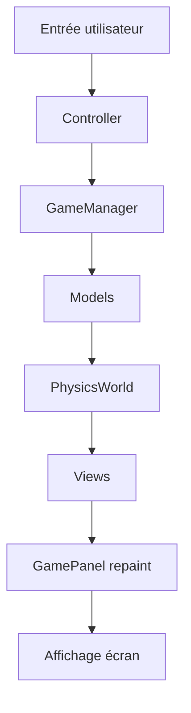

# 🏗️ Diagramme d'Architecture - Projet Worms

## 📋 Vue d'ensemble
Ce document présente un diagramme complet des classes principales et leurs interactions dans le projet Worms, organisé selon le pattern **MVC (Modèle-Vue-Contrôleur)**.

---

## 🎯 Classes Principales et Interactions

### 🚀 Point d'entrée
- **`GameLauncher`** : Classe principale qui initialise le jeu
  - Crée `GameManager` et `GameLoop`
  - Lance la boucle de jeu

### ⚙️ Noyau du Jeu (MVC)
```
┌─────────────────┐
│   GameLauncher  │
└─────────────────┘
         ↓
┌─────────────────┐ ◄───► ┌─────────────────┐
│   GameManager   │       │    GameLoop     │
└─────────────────┘       └─────────────────┘
         ↓
    ┌─────────────┐
    │ Controllers │ ◄───► │    Models     │ ◄───► │    Views     │
    └─────────────┘       └─────────────┘       └─────────────┘
```

---

## 🔍 Détail des Interactions

### 🎮 GameManager (Cœur logique)
**Responsabilités :** Gère les équipes, personnages, physique, rounds
- **Équipes :** `TeamModel[]` (maintenant dynamique)
- **Personnages :** `CharacterModel[]`
- **Physique :** `PhysicsWorld`
- **Terrain :** `GroundModel` / `BlockGridModel`

**Interactions principales :**
- **→ `GameLoop`** : Fournit l'état du jeu pour la boucle
- **→ `Controllers`** : Reçoit les entrées utilisateur
- **→ `Models`** : Met à jour la logique (équipes, inventaire, projectiles)
- **→ `Views`** : Met à jour l'affichage via `GamePanel`

### 🔄 GameLoop (Boucle principale)
**Responsabilités :** Gestion du timing (60 FPS), physique, rendu
- **Timer :** `javax.swing.Timer` à 16ms (~60 FPS)
- **Physique :** Mise à jour `PhysicsWorld`
- **Rendu :** Appel `repaint()` sur `GamePanel`

**Interactions :**
- **→ `GameManager`** : Appelle `update()` pour la logique
- **→ `GamePanel`** : Déclenche le `repaint()`
- **→ `PhysicsWorld`** : Met à jour la physique JBox2D

### 🎮 Controllers (Gestion des entrées)
| Classe | Responsabilité | Interactions |
|--------|---------------|--------------|
| **`CharacterController`** | Mouvement, tir, changement d'arme | → `GameManager`, → `CharacterModel` |
| **`CameraController`** | Zoom, déplacement caméra | → `CameraModel` |
| **`ItemController`** | Gestion projectiles/items | → `GameManager`, → `Projectile` |
| **`SwingInputController`** | Capture clavier/souris | → Tous les controllers |

### 📊 Models (Logique métier)
| Catégorie | Classes principales | Responsabilités |
|-----------|-------------------|---------------|
| **Équipes** | `TeamModel`, `TeamInitialisation` | Gestion des équipes de worms |
| **Personnages** | `CharacterModel` | Position, vie, inventaire d'un worm |
| **Terrain** | `GroundModel`, `BlockGridModel`, `TerrainGenerator` | Géométrie du terrain |
| **Physique** | `PhysicsWorld` | Monde JBox2D, collisions |
| **Items** | `InventoryModel`, `Item`, `Weapon`, `Gadget` | Armes, gadgets, inventaire |
| **Projectiles** | `Projectile` | Physique des tirs |
| **Utilitaires** | `PerlinNoise`, `PlayerData` | Génération procédurale, sauvegarde |

### 👁️ Views (Affichage)
| Classe | Responsabilité | Technologies |
|--------|---------------|--------------|
| **`GamePanel`** | Panel principal, rendu complet | Swing, Graphics2D |
| **`TeamView`** | Affichage d'une équipe | Sprites, couleurs |
| **`CharacterView`** | Rendu d'un worm | Images, animations |
| **`InventoryOverlay`** | Interface inventaire | JDialog, boutons |
| **`TrajectoryRenderer`** | Trajectoire de tir (Angry Birds) | Mathématiques, courbes |
| **`ProjectileView`** | Affichage projectiles | Particules, effets |

---

## 🔄 Flux de Données Typique



### Séquence détaillée :
1. **Entrée** → `SwingInputController` détecte l'événement
2. **Controller** → Transmet à `GameManager`
3. **Logique** → `GameManager` met à jour les `Models`
4. **Physique** → `GameLoop` appelle `PhysicsWorld.step()`
5. **Rendu** → `GamePanel.paintComponent()` dessine tout
6. **Affichage** → Swing met à jour l'écran

---

## 🏛️ Architecture MVC Implémentée

### 📂 Modèle (Model)
- **Logique métier** : `TeamModel`, `CharacterModel`, `PhysicsWorld`
- **Données** : `PlayerData`, `InventoryModel`
- **Calculs** : `PerlinNoise`, `TerrainGenerator`

### 👁️ Vue (View)
- **Swing Components** : `GamePanel`, `InventoryOverlay`
- **Rendu graphique** : `CharacterView`, `TeamView`
- **Effets visuels** : `TrajectoryRenderer`, `ProjectileView`

### 🎮 Contrôleur (Controller)
- **Entrées** : `SwingInputController`, `CharacterController`
- **Coordination** : `GameManager`, `GameLoop`
- **Actions** : `ItemController`, `CameraController`

---

## 🎯 Points Clés d'Architecture

### ✅ Points forts
- **Séparation claire MVC** : Logique, affichage et contrôle séparés
- **Extensibilité** : Support N équipes, ajout facile de nouvelles armes
- **Performance** : Boucle 60 FPS optimisée, physique JBox2D
- **Testabilité** : Classes isolées, nombreux tests unitaires

### 🔧 Composants critiques
- **`GameManager`** : Cœur du jeu, coordonne tout
- **`GameLoop`** : Maintient le rythme du jeu
- **`PhysicsWorld`** : Gestion collisions et physique
- **`GamePanel`** : Rendu graphique principal

### 🌊 Mode Console
- Classes parallèles dans `console/` : `ConsoleLauncher`, `ConsoleGameManager`
- Version textuelle complète sans interface graphique

---

*Ce diagramme montre comment les 50+ classes du projet Worms s'articulent pour créer une expérience de jeu cohérente et extensible.*</content>
<parameter name="filePath">c:\Users\rilil\ECOLE\projet-worms\DIAGRAMME.md