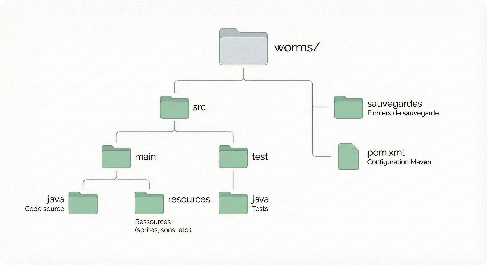
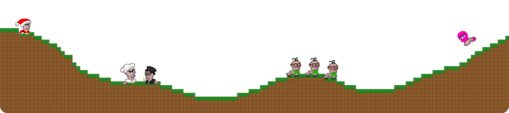

# Wormiliton

Projet Worms | Groupe 5 Équipe 4


Jeu 2D de type [Worms](https://fr.wikipedia.org/wiki/Worms_(jeu_vidéo)) développé en Java, où des équipes de vers s'affrontent tour à tour sur un terrain destructible avec un petit arsenal soumis à une physique simple (gravité, collisions, vent)

## Prérequis

- **Java 23, 24 ou 25**
- **Apache Maven** 3.9

## Compilation

Depuis le répertoire racine du projet, naviguez vers le dossier `worms` et compilez avec Maven :

```bash
cd wormss
mvn clean package
```

Cette commande va :
1. Télécharger toutes les dépendances nécessaires
2. Compiler le code source
3. Exécuter les tests
4. Générer un fichier JAR exécutable dans `target/`

Le fichier JAR généré sera nommé `worms-app.jar` et contiendra toutes les dépendances nécessaires.

## Exécution

Après la compilation, **depuis le dossier racine du projet** :

```bash
java -jar worms/target/worms-app.jar
```

## Utilisation du jeu

### Menu principal

Au lancement, vous arrivez sur le menu principal avec les options suivantes :
- **Nouvelle Partie** : Démarrer une nouvelle partie
- **Poursuivre une partie** : Charger une partie sauvegardée
- **Comment jouer** : Apprendre les bases du jeu
- **Reglages** : Configurer les paramètres du jeu (map, équipes, etc.)
- **Quitter** : Fermer le jeu

### Déroulement d'une partie

1. Des équipes s'affrontent tour par tour
2. Chaque tour, vous contrôlez un ver de votre équipe
3. Déplacez-vous sur le terrain et utilisez votre arsenal pour éliminer ou pousser dans l'eau l'équipe adverse
4. Le terrain est destructible - utilisez-le à votre avantage !
5. La partie se termine lorsqu'une équipe n'a plus de vers

### Contrôles en jeu

- **Q/D** : Déplacer le ver
- **Z** : Sauter
- **Clic gauche** : Tirer/Utiliser l'arme ou gadget
- **Scroll** : Zoomer/Dézoomer la caméra

### Inventaire

Pendant la partie, appuyez sur le sac pour ouvrir l'inventaire avec ses trois onglets :

- Armes
    - Consultez et sélectionnez vos armes disponibles

- Gadget
    - Accédez à vos items spéciaux et potions

- Boutique
    - Jouez à des mini-jeux pour gagner de l'argent supplémentaire
    - Achetez des skins, des armes et des potions

### Arsenal disponible

**Armes :**
- **Batte de baseball**
- **Grenade**
- **AK-47**
- **Bazooka**

**Gadgets :**
- **Potion Heal** : Restaure 50 HP
- **Potion Speed** : Augmente la vitesse
- **Potion Jump** : Améliore la hauteur de saut
- **Potion Shield** : Ajoute du shield

### Système de sauvegarde

On peut sauver des parties dans le dossier `sauvegardes/` :
- `sauvegarde.txt` : Sauvegarde manuelle
- `player_save.txt` : Sauvegarde des profils joueurs

## Tests

Pour exécuter les tests unitaires :

```bash
cd worms
mvn test
```

Pour générer un rapport de couverture de code avec JaCoCo :

```bash
cd worms
mvn clean verify
```

Le rapport sera disponible dans `target/site/jacoco/index.html`

## Structure du projet



Voir [ARCHITECTURE.md](worms/ARCHITECTURE.md) pour la structure complète

## Documentation

- [DESIGN.md](DESIGN.md) : Décisions de conception
- [CHANGELOG.md](CHANGELOG.md) : Historique des modifications
- [CONTRIBUTING.md](CONTRIBUTING.md) : Guide de contribution
- [AUTHORS.md](AUTHORS.md) : Liste des contributeurs et leur principaux contributions

## Licence

Voir le fichier [LICENSE](LICENSE) pour les détails.


